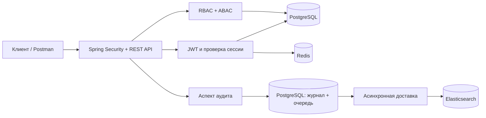

# EnterpriseIAM

**EnterpriseIAM — REST API для аутентификации, управления доступом и аудита действий.**
Пользователь входит по email и паролю, получает токены и обращается к защищённым ресурсам.
Сервис проверяет не только права его роли, но и отдел, уровень допуска, владельца ресурса,
время запроса и IP-адрес. Чувствительные операции оставляют запись в журнале аудита.

В проекте есть backend API. Веб-интерфейса, страницы регистрации и административной панели пока нет.
Пользоваться им можно через `curl`, Postman или собственный клиент.

## Содержание

- [Как устроено приложение](#architecture)
- [Локальный запуск с нуля](#local-start)
- [Первый пользователь и ресурс](#first-user)
- [Практический сценарий работы с API](#api-guide)
- [Подключение своего приложения](#integration)
- [Правила доступа: RBAC и ABAC](#authorization)
- [Как работает и где смотреть аудит](#audit)
- [Настройки](#configuration)
- [Тестирование](#testing)
- [Частые проблемы](#troubleshooting)
- [Развёртывание вне локального окружения](#deployment)
- [Навигация по коду](#source-map)

<a id="architecture"></a>
## Как устроено приложение



| Компонент | Для чего нужен |
| --- | --- |
| Java 21, Spring Boot 3.3.13 | Запуск приложения, HTTP API и транзакции |
| Spring Security 6, JWT | Вход, проверка подписи токенов и защита методов |
| PostgreSQL | Пользователи, роли, права, сессии, refresh-токены, ресурсы и исходный журнал аудита |
| Flyway | Создание и обновление схемы через миграции V1–V4 |
| Redis | Отзыв access-токенов и ограничение частоты login/refresh |
| Elasticsearch 8.13.4 | Поиск и анализ доставленных событий аудита |
| MapStruct, Lombok | Преобразование DTO и сокращение шаблонного кода |

**Что происходит при запросе:**

1. При входе сервис проверяет пароль и статус учётной записи.
2. Выдаёт access-токен на **5 минут** и одноразовый refresh-токен. Семейство refresh-токенов живёт **30 дней**.
3. Для защищённого запроса проверяет JWT, отзыв токена в Redis и актуальное состояние пользователя/сессии в PostgreSQL.
4. Для ресурса применяет RBAC и ABAC. Атрибуты ресурса и права пользователя берутся из БД.
5. Записывает начало и результат чувствительной операции в PostgreSQL; отдельный worker доставляет события в Elasticsearch.

HTTP-сессии и cookies не используются. При этом сервер хранит **состояние отзыва** в БД и Redis:
«stateless JWT» здесь не означает отсутствие обращений к хранилищам.

<a id="local-start"></a>
## Локальный запуск с нуля

Ниже приложение работает **на вашем компьютере**, зависимости — в Docker. Команды рассчитаны
на Bash в Linux/macOS или WSL и выполняются из корня проекта. Для примеров нужны:

- JDK **21** и Maven **3.6.3+**, ветка 3.x;
- Docker с запущенным daemon;
- `curl`, `jq`, `openssl`, `python3`;
- свободные порты `8080`, `5432`, `6379`, `9200` и достаточно памяти для Elasticsearch.

Проверка Java и Maven:

```bash
java -version
mvn -version
```

> Пароли `local-...` ниже предназначены только для локального стенда. Порты зависимостей
> привязаны к `127.0.0.1`; TLS отключён только в этом примере. Docker Compose и Dockerfile
> в репозитории не предусмотрены — ниже используются обычные `docker run`.

### 1. Запустите зависимости

Именованные volumes сохранят данные после остановки контейнеров.

```bash
docker run -d --name enterpriseiam-postgres \
  -p 127.0.0.1:5432:5432 \
  -e POSTGRES_DB=enterprise_iam \
  -e POSTGRES_PASSWORD=local-postgres-admin \
  -v enterpriseiam-postgres-data:/var/lib/postgresql/data \
  postgres:16.9-alpine

docker run -d --name enterpriseiam-redis \
  -p 127.0.0.1:6379:6379 \
  -v enterpriseiam-redis-data:/data \
  redis:7.2.5-alpine \
  redis-server --requirepass local-redis-password \
  --appendonly yes --maxmemory-policy noeviction

docker run -d --name enterpriseiam-elasticsearch \
  -p 127.0.0.1:9200:9200 -m 1g \
  -e discovery.type=single-node \
  -e xpack.security.enabled=true \
  -e xpack.security.enrollment.enabled=false \
  -e xpack.security.http.ssl.enabled=false \
  -e xpack.security.transport.ssl.enabled=false \
  -e ELASTIC_PASSWORD=local-elastic-admin \
  -v enterpriseiam-elasticsearch-data:/usr/share/elasticsearch/data \
  docker.elastic.co/elasticsearch/elasticsearch:8.13.4
```

Дождитесь готовности сервисов; Elasticsearch может запускаться дольше остальных:

```bash
docker exec enterpriseiam-postgres pg_isready -U postgres -d enterprise_iam
docker exec -e REDISCLI_AUTH=local-redis-password enterpriseiam-redis redis-cli ping
curl --fail-with-body -u elastic:local-elastic-admin http://127.0.0.1:9200
```

Ожидаются `accepting connections`, `PONG` и JSON с версией Elasticsearch.
Если контейнер завершился, посмотрите `docker logs enterpriseiam-elasticsearch`.
Требования к Docker и памяти описаны в [руководстве Elasticsearch 8.13](https://www.elastic.co/guide/en/elasticsearch/reference/8.13/docker.html).

### 2. Подготовьте пользователей PostgreSQL

На **новой локальной БД** выполните один раз. Миграции будут работать от владельца схемы,
а приложение — от отдельной учётной записи с правами на данные:

```bash
docker exec -i enterpriseiam-postgres psql -U postgres -d enterprise_iam -v ON_ERROR_STOP=1 <<'SQL'
CREATE ROLE enterprise_iam_migrator LOGIN PASSWORD 'local-migrator-password';
CREATE ROLE enterprise_iam_app LOGIN PASSWORD 'local-app-password';
CREATE SCHEMA iam AUTHORIZATION enterprise_iam_migrator;
GRANT USAGE ON SCHEMA iam TO enterprise_iam_app;
ALTER DEFAULT PRIVILEGES FOR ROLE enterprise_iam_migrator IN SCHEMA iam
    GRANT SELECT, INSERT, UPDATE, DELETE ON TABLES TO enterprise_iam_app;
SQL
```

Таблицы вручную создавать не нужно: Flyway создаст их при первом запуске приложения.

### 3. Подготовьте Elasticsearch

Приложение получает только право добавлять документы. Шаблон, роль, пользователя и индексы
создаёт администратор, а не audit worker.

```bash
export ES_URL=http://127.0.0.1:9200
export ES_ADMIN_PASSWORD=local-elastic-admin

# Для одного локального узла убираем реплику из шаблона; исходный файл не меняем.
jq '.template.settings.number_of_replicas = 0' ops/elasticsearch/audit-index-template.json \
  | curl --fail-with-body -u "elastic:$ES_ADMIN_PASSWORD" \
      -X PUT "$ES_URL/_index_template/enterpriseiam-audit" \
      -H 'Content-Type: application/json' --data-binary @-

curl --fail-with-body -u "elastic:$ES_ADMIN_PASSWORD" \
  -X PUT "$ES_URL/_security/role/enterpriseiam_audit_writer" \
  -H 'Content-Type: application/json' \
  --data-binary @ops/elasticsearch/audit-writer-role.json

curl --fail-with-body -u "elastic:$ES_ADMIN_PASSWORD" \
  -X PUT "$ES_URL/_security/user/enterpriseiam_audit" \
  -H 'Content-Type: application/json' \
  -d '{"password":"local-audit-password","roles":["enterpriseiam_audit_writer"]}'

curl --fail-with-body -u "elastic:$ES_ADMIN_PASSWORD" \
  -X PUT "$ES_URL/enterpriseiam-audit-$(date -u +%Y.%m.%d)"
```

**Индекс нужен для каждого дня UTC.** Последнюю команду выполняйте для нового дня перед
работой со стендом. Если индекс уже существует, Elasticsearch вернёт `resource_already_exists_exception` —
повторно создавать или удалять его не нужно. В production создание следующих дней автоматизируют.

### 4. Создайте ключи JWT и файл окружения

```bash
umask 077
mkdir -p .local/keys
openssl genpkey -algorithm RSA -pkeyopt rsa_keygen_bits:3072 -out .local/keys/iam-private.pem
openssl pkey -in .local/keys/iam-private.pem -pubout -out .local/keys/iam-public.pem

cat > .local/enterpriseiam.env <<EOF
DB_URL=jdbc:postgresql://127.0.0.1:5432/enterprise_iam
DB_USERNAME=enterprise_iam_app
DB_PASSWORD=local-app-password
FLYWAY_USERNAME=enterprise_iam_migrator
FLYWAY_PASSWORD=local-migrator-password
REDIS_HOST=127.0.0.1
REDIS_USERNAME=default
REDIS_PASSWORD=local-redis-password
REDIS_SSL_ENABLED=false
ELASTICSEARCH_URIS=http://127.0.0.1:9200
ELASTICSEARCH_USERNAME=enterpriseiam_audit
ELASTICSEARCH_PASSWORD=local-audit-password
IAM_JWT_ISSUER=https://iam.local.example
IAM_JWT_AUDIENCE=enterprise-api
IAM_JWT_KEY_ID=local-key-1
IAM_JWT_PRIVATE_KEY=file:$PWD/.local/keys/iam-private.pem
IAM_JWT_PUBLIC_KEY=file:$PWD/.local/keys/iam-public.pem
IAM_AUTH_RATE_LIMIT_KEY=$(openssl rand -base64 32)
IAM_ABAC_ZONE_ID=UTC
IAM_ABAC_ALLOWED_CIDRS=127.0.0.1/32,::1/128
EOF
```

В примере путь к проекту должен быть без пробелов. Если в пути есть пробелы, заключите значения
`IAM_JWT_PRIVATE_KEY` и `IAM_JWT_PUBLIC_KEY` в кавычки в созданном shell-файле.
`.local/` исключена из Git. Не генерируйте ключи заново при каждом запуске:
это сделает ранее выданные access-токены недействительными.

`IAM_JWT_ISSUER` — идентификатор издателя внутри JWT. Для него не требуется локальный DNS или HTTPS-сервер;
сам API в этом примере доступен по `http://127.0.0.1:8080`.

### 5. Запустите приложение

В первом терминале загрузите окружение и запустите Spring Boot:

```bash
set -a
source .local/enterpriseiam.env
set +a
mvn spring-boot:run
```

Spring Boot **не загружает `.env` автоматически**. В новом терминале нужно снова выполнить `source`
с `set -a`, иначе переменные не будут переданы процессу Java.

При старте Flyway применит миграции, Hibernate проверит схему, а JWT-конфигурация проверит ключи.
Проверка приложения из второго терминала:

```bash
curl --fail-with-body http://127.0.0.1:8080/actuator/health/liveness
curl --fail-with-body http://127.0.0.1:8080/actuator/health/readiness
```

Ожидаемый ответ — `{"status":"UP"}`. Эти probes не заменяют проверку подключения к каждому хранилищу
и доставку тестового события аудита. Корневой URL `/` не содержит интерфейса и закрыт security chain.

После первой миграции ограничьте права приложения на служебные таблицы:

```bash
docker exec -i enterpriseiam-postgres psql -U postgres -d enterprise_iam -v ON_ERROR_STOP=1 <<'SQL'
REVOKE ALL ON TABLE iam.flyway_schema_history FROM enterprise_iam_app;
REVOKE UPDATE, DELETE, TRUNCATE, REFERENCES, TRIGGER
    ON TABLE iam.audit_events FROM enterprise_iam_app;
REVOKE DELETE, TRUNCATE, REFERENCES, TRIGGER
    ON TABLE iam.audit_delivery FROM enterprise_iam_app;
SQL
```

**Запуск из IDE:** JDK 21, главный класс
[`EnterpriseIamApplication`](src/main/java/com/enterpriseiam/EnterpriseIamApplication.java),
рабочая директория — корень проекта. Перенесите переменные из `.local/enterpriseiam.env` в Environment
variables конфигурации запуска. Подстановка `$PWD`/`$(...)` в IDE не нужна: созданный файл уже содержит значения.
Для Lombok/MapStruct должна быть включена обработка аннотаций. Одновременно запускайте только один вариант на порту 8080.

**Запуск JAR вместо Maven:** после загрузки того же окружения выполните:

```bash
mvn verify
java -jar target/enterprise-iam-0.1.0-SNAPSHOT.jar
```

<a id="first-user"></a>
## Первый пользователь и ресурс

Пустая база **не содержит пользователей или стандартного пароля администратора**. Endpoint регистрации
не реализован. Для знакомства с API создадим локальную учётную запись, роль и ресурс через SQL.
Это процедура подготовки стенда; прямые SQL-изменения не проходят через AOP-аудит приложения.

### 1. Получите хеш пароля

Во втором терминале выполните команду и придумайте пароль. Ввод не отображается;
запомните его для следующего шага. Скрипт повторяет текущий формат `pbkdf2-sha256` приложения:
16 байт соли, 600 000 итераций, SHA-256, результат 32 байта.

```bash
DEMO_PASSWORD_HASH=$(python3 - <<'PY'
import getpass, hashlib, secrets
password = getpass.getpass('Пароль для demo@example.com: ')
if not password or len(password.encode('utf-16-le')) // 2 > 1024 or password.isspace():
    raise SystemExit('Нужен непустой пароль длиной до 1024 UTF-16 символов')
salt = secrets.token_bytes(16)
key = hashlib.pbkdf2_hmac('sha256', password.encode('utf-8'), salt, 600_000, dklen=32)
print('{pbkdf2-sha256}' + (salt + key).hex())
PY
)
test -n "$DEMO_PASSWORD_HASH" || { echo 'Хеш не создан'; exit 1; }
```

### 2. Добавьте данные

Выполняйте один раз на новом стенде после успешного старта приложения:

```bash
docker exec -i enterpriseiam-postgres psql -U postgres -d enterprise_iam \
  -v ON_ERROR_STOP=1 -v password_hash="$DEMO_PASSWORD_HASH" <<'SQL'
BEGIN;
INSERT INTO iam.users (id, email, password_hash, status, department, clearance_level)
VALUES ('11111111-1111-4111-8111-111111111111', 'demo@example.com',
        :'password_hash', 'ACTIVE', 'Finance', 3);

INSERT INTO iam.roles (id, name)
VALUES ('22222222-2222-4222-8222-222222222222', 'FINANCE_ANALYST');

INSERT INTO iam.permissions (id, name) VALUES
    ('44444444-4444-4444-8444-444444444444', 'RESOURCE:READ'),
    ('55555555-5555-4555-8555-555555555555', 'RESOURCE:WRITE');

INSERT INTO iam.user_roles (user_id, role_id)
VALUES ('11111111-1111-4111-8111-111111111111', '22222222-2222-4222-8222-222222222222');

INSERT INTO iam.role_permissions (role_id, permission_id) VALUES
    ('22222222-2222-4222-8222-222222222222', '44444444-4444-4444-8444-444444444444'),
    ('22222222-2222-4222-8222-222222222222', '55555555-5555-4555-8555-555555555555');

INSERT INTO iam.secured_resources (id, owner_id, department, classification, content)
VALUES ('33333333-3333-4333-8333-333333333333',
        '11111111-1111-4111-8111-111111111111', 'Finance', 2, 'Первый защищённый документ');
COMMIT;
SQL
unset DEMO_PASSWORD_HASH
```

У пользователя есть READ/WRITE, он владелец ресурса, отделы совпадают, допуск `3` выше классификации `2`.
Остаются ограничения IP и рабочего времени.

**Если сейчас вечер или выходной:** стандартная ABAC-политика разрешает запросы только
с понедельника по пятницу, с 09:00 включительно до 17:00 исключительно, по UTC.
Для локальной демонстрации остановите приложение и запустите его с расширенным расписанием:

```bash
mvn spring-boot:run -Dspring-boot.run.arguments="--iam.abac.allowed-days=MONDAY,TUESDAY,WEDNESDAY,THURSDAY,FRIDAY,SATURDAY,SUNDAY --iam.abac.opening-time=00:00 --iam.abac.closing-time=23:59:59.999999999"
```

Окружение из предыдущего раздела должно оставаться загруженным. Аргументы меняют только этот запуск;
проверки прав, владельца, отдела, уровня допуска и IP остаются включёнными.

<a id="api-guide"></a>
## Практический сценарий работы с API

Все команды ниже выполняйте последовательно в одном втором терминале. Нужны `curl` и `jq`.

| Метод и путь | Назначение | Нужен access-токен |
| --- | --- | --- |
| `POST /api/v1/auth/login` | Вход по email/паролю | Нет |
| `POST /api/v1/auth/refresh` | Однократный обмен refresh-токена | Нет |
| `POST /api/v1/auth/logout` | Отзыв текущего семейства сессии | Да |
| `GET /api/v1/resources/{id}` | Чтение ресурса | Да, плюс READ-политика |
| `PUT /api/v1/resources/{id}` | Изменение содержимого | Да, плюс WRITE-политика |

### Войти

```bash
export API_URL=http://127.0.0.1:8080
export RESOURCE_ID=33333333-3333-4333-8333-333333333333
read -r -s -p 'Пароль demo@example.com: ' DEMO_PASSWORD
printf '\n'
TOKENS=$(printf '%s' "$DEMO_PASSWORD" \
  | jq -Rs '{email:"demo@example.com",password:.}' \
  | curl --fail-with-body -sS "$API_URL/api/v1/auth/login" \
      -H 'Content-Type: application/json' --data-binary @-)
unset DEMO_PASSWORD
ACCESS_TOKEN=$(printf '%s' "$TOKENS" | jq -er '.accessToken')
REFRESH_TOKEN=$(printf '%s' "$TOKENS" | jq -er '.refreshToken')
printf '%s' "$TOKENS" | jq '{tokenType,accessTokenExpiresAt,refreshTokenExpiresAt}'
```

При ошибке остановитесь и разберите ответ, прежде чем выполнять следующие команды.
Успешный ответ имеет пять полей:

```json
{
  "tokenType": "Bearer",
  "accessToken": "<подписанный JWT>",
  "refreshToken": "<одноразовая случайная строка>",
  "accessTokenExpiresAt": "2026-10-23T12:05:00Z",
  "refreshTokenExpiresAt": "2026-11-22T12:00:00Z"
}
```

Даты здесь иллюстративные. Сервер возвращает абсолютные UTC timestamps.
Токены не нужно выводить в логи или передавать в URL; ответы авторизации имеют `Cache-Control: no-store`.

### Прочитать ресурс

```bash
RESOURCE=$(curl --fail-with-body -sS "$API_URL/api/v1/resources/$RESOURCE_ID" \
  -H "Authorization: Bearer $ACCESS_TOKEN")
printf '%s' "$RESOURCE" | jq .
VERSION=$(printf '%s' "$RESOURCE" | jq -er '.version')
```

Ответ содержит `id`, `ownerId`, `department`, `classification`, `content`, `version`.
На новом стенде версия равна `0`.

### Изменить содержимое

```bash
jq -n --arg content 'Обновлённый документ' --argjson version "$VERSION" \
  '{content:$content,expectedVersion:$version}' \
  | curl --fail-with-body -sS -X PUT "$API_URL/api/v1/resources/$RESOURCE_ID" \
      -H "Authorization: Bearer $ACCESS_TOKEN" \
      -H 'Content-Type: application/json' --data-binary @- | jq .
```

Успешный ответ содержит новую версию. Для следующей записи используйте её или заново прочитайте ресурс.
Повтор старой `expectedVersion` вернёт `409`: это защита от потери чужих изменений.
Через этот API нельзя менять владельца, отдел или классификацию ресурса.

### Обновить токены

```bash
TOKENS=$(printf '%s' "$REFRESH_TOKEN" | jq -Rs '{refreshToken:.}' \
  | curl --fail-with-body -sS "$API_URL/api/v1/auth/refresh" \
      -H 'Content-Type: application/json' --data-binary @-)
ACCESS_TOKEN=$(printf '%s' "$TOKENS" | jq -er '.accessToken')
REFRESH_TOKEN=$(printf '%s' "$TOKENS" | jq -er '.refreshToken')
```

**Сохраняйте оба новых токена.** Старый refresh-токен больше нельзя использовать.
Его повторное предъявление отзывает всё семейство, включая ранее выданные access-токены.
Не запускайте несколько refresh-запросов параллельно и не повторяйте обмен вслепую при потере ответа.
Ротация не продлевает исходный 30-дневный срок семейства.

### Выйти

```bash
curl --fail-with-body -i -X POST "$API_URL/api/v1/auth/logout" \
  -H "Authorization: Bearer $ACCESS_TOKEN"
unset ACCESS_TOKEN REFRESH_TOKEN TOKENS
```

Ответ — `204 No Content`. Отзывается текущая сессия/семейство, а не все отдельные входы пользователя.
После logout связанные токены не проходят следующую проверку; уже исполняющийся запрос может завершиться.
Если access-токен истёк, сначала нужен успешный refresh, чтобы вызвать защищённый logout.

### Postman

Создайте Environment с `baseUrl=http://127.0.0.1:8080` и `resourceId` из примера.
Для login/refresh выберите **No Auth**, Body → raw → JSON. Для ресурсов и logout —
**Bearer Token** со значением access-токена. Сохраняйте новую пару после каждого refresh.
OpenAPI/Swagger UI в текущем проекте не подключён.

<a id="integration"></a>
## Подключение своего приложения

Клиенту нужен базовый URL API и описанный выше HTTP-контракт:

1. Отправить email/пароль на `/auth/login` с префиксом `/api/v1`.
2. Передавать access-токен только в `Authorization: Bearer ...`.
3. При истечении токена выполнить **один общий refresh** для параллельных запросов клиента,
   сохранить новую пару и повторить исходный запрос не более одного раза.
4. Если refresh отклонён — очистить локальные токены и запросить повторный вход.
5. `403` обрабатывать как отказ в доступе, `409` — как конфликт версии, `429` — с учётом `Retry-After`.

Для браузерного frontend учитывайте, что отдельная CORS-политика здесь не настроена:
произвольный другой origin не получает доступ автоматически. Можно разместить frontend и API
на одном origin через reverse proxy либо добавить явный список разрешённых origins в security configuration.
Не отключайте проверки доступа ради CORS. Выбор хранилища токенов остаётся частью клиентской архитектуры:
сервис сам не устанавливает cookies. Переход к cookie-аутентификации требует отдельной защиты от CSRF.

**Подключение другого backend:** проект пока не является полноценным OAuth2/OIDC Authorization Server.
Здесь нет authorization-code flow, discovery endpoint, JWKS endpoint или client credentials.
Указание issuer в стороннем resource server само по себе не обеспечит интеграцию.
Для локальной проверки подписи другому сервису понадобятся публичный RSA-ключ, issuer, audience и
те же правила проверки claims. Но одной подписи недостаточно для немедленного отзыва сессии и
актуальных RBAC/ABAC-проверок: для внешних сервисов этот протокол ещё нужно спроектировать.

<a id="authorization"></a>
## Правила доступа: RBAC и ABAC

**RBAC** — какие действия разрешает роль:

```text
Пользователь → FINANCE_ANALYST → RESOURCE:READ, RESOURCE:WRITE
```

**ABAC** — при каких обстоятельствах эти действия разрешены. Все условия должны выполняться:

| Проверка | READ | WRITE |
| --- | --- | --- |
| Право пользователя | `RESOURCE:READ` | `RESOURCE:WRITE` |
| Связь с ресурсом | Владелец **или** тот же отдел | Владелец **и** тот же отдел |
| Допуск | `clearanceLevel >= classification`, диапазон 0–4 | То же |
| День и время | Разрешённый день; начало включительно, конец исключительно | То же |
| IP | Прямой адрес соединения входит в разрешённый CIDR | То же |

Названия отделов сравниваются с учётом регистра: `Finance` и `finance` различаются.
Роль с названием `ADMIN` не даёт автоматического обхода ограничений. Неизвестные ресурсы
и отсутствующие атрибуты также приводят к отказу.

По умолчанию: **Пн–Пт, 09:00–17:00 UTC**, а список разрешённых IP **пуст**.
Без `IAM_ABAC_ALLOWED_CIDRS` чтение и изменение ресурсов всегда запрещены.

За reverse proxy приложение видит IP прокси. `X-Forwarded-For` намеренно игнорируется.
Если прокси добавлен в разрешённую сеть, сетевую проверку проходят запросы через него;
это не проверка адресов конечных пользователей. Для неё нужна отдельная доверенная настройка proxy boundary.

В коде политики применяются через `@PreAuthorize("hasPermission(#resource, 'READ')")`.
`ResourceService` открывает транзакцию, отдельный proxy `ResourceOperations` запускает проверку,
а evaluator блокирует строку ресурса до завершения операции. Так владелец/классификация не меняются
между решением о доступе и использованием ресурса. Изменения прав и статуса пользователя читаются из БД,
а не из устаревшего списка ролей в JWT.

<a id="audit"></a>
## Как работает и где смотреть аудит

Методы с `@AuditAction` перехватывает AOP-аспект. Контроллеру и бизнес-методу не нужно вручную писать логи.
События содержат action, actor, время, UUID вызова, фазу, разрешённые аргументы и ограниченные HTTP-метаданные.
Пароли, токены, содержимое ресурсов, возвращаемые объекты и тексты исключений в payload не попадают.
Для неаутентифицированного login/refresh actor равен `anonymous`: введённый email не считается проверенной личностью.

| Хранилище | Назначение |
| --- | --- |
| `iam.audit_events` | Исходный append-only журнал; UPDATE/DELETE/TRUNCATE блокируются триггерами |
| `iam.audit_delivery` | Состояние доставки, попытки, lease и срок следующего повтора |
| `enterpriseiam-audit-YYYY.MM.dd` | Поисковая копия в Elasticsearch, дата события по UTC |

До вызова метода отдельно фиксируется `STARTED`. Если запись не удалась, метод не выполняется.
Для ресурсов `SUCCEEDED` фиксируется в одной транзакции с изменением; при откате успешная запись
также откатывается, затем отдельно записывается `FAILED`. Отказы ABAC внутри этого пути тоже аудируются.

Worker доставляет события асинхронно, а периодический опрос восстанавливает работу после перезапуска.
События не теряются из-за переполнения очереди executor и не удаляются после превышения числа попыток.
Elasticsearch получает только create-операции с постоянным ID; подтверждённый конфликт существующего
документа считается успешной повторной доставкой.

### Посмотреть журнал PostgreSQL

```bash
docker exec -i enterpriseiam-postgres psql -U postgres -d enterprise_iam <<'SQL'
SELECT created_at,
       payload ->> 'action' AS action,
       payload ->> 'phase' AS phase,
       payload ->> 'actorId' AS actor,
       payload ->> 'outcomeType' AS outcome
FROM iam.audit_events
ORDER BY created_at DESC
LIMIT 20;

SELECT count(*) AS pending, min(next_attempt_at) AS earliest_due
FROM iam.audit_delivery
WHERE delivered_at IS NULL;
SQL
```

### Найти события в Elasticsearch

Подождите несколько секунд после API-запроса: доставка и обновление поискового индекса асинхронны.
На локальном стенде используйте административную учётную запись; в production — отдельную read-only роль:

```bash
curl --fail-with-body -sS -u elastic:local-elastic-admin \
  'http://127.0.0.1:9200/enterpriseiam-audit-*/_search' \
  -H 'Content-Type: application/json' \
  -d '{"size":20,"sort":[{"occurredAt":"desc"}],"query":{"match_all":{}}}' | jq .
```

Пользователь приложения `enterpriseiam_audit` не имеет права читать, менять, удалять документы или
создавать индексы. Поэтому его `403` при `_search` ожидаем. При недоступности Elasticsearch записи
накапливаются в PostgreSQL. Проверьте наличие индексов для **всех дат событий**, включая старый backlog.

### Границы гарантий

- Для auth/session операций используются отдельные транзакции. Авария между изменением сессии и
  записью результата может оставить только `STARTED`. Это **неизвестный исход**, требующий сверки,
  а не доказательство ошибки или успеха. Ошибка записи в afterCompletion уже не может изменить завершённый ответ.
- Невалидный bearer token, ошибки JSON/валидации, ограничения размера и rate limit возникают до
  вызова сервиса и не создают method-audit события. Для них нужен отдельный ingress/security audit, если он требуется.
- Запрет изменения действует для прикладной учётной записи. Администраторы БД/кластера и владельцы
  инфраструктуры остаются привилегированными. SHA-256 payload — контроль совпадения повторов, не цифровая подпись.
  Для защиты от администратора требуется независимый WORM-архив и политика хранения.
- Не используйте rollover alias и не пересоздавайте индексы, пока возможны повторы доставки:
  уникальность события обеспечивается в конкретном индексе. Очистка/архивирование требуют отдельного регламента.

<a id="configuration"></a>
## Настройки

Основной файл — [`application.yml`](src/main/resources/application.yml).
Секреты передаются окружением или механизмом секретов deployment-платформы.

| Переменная | Смысл / значение по умолчанию |
| --- | --- |
| `DB_URL` | JDBC URL PostgreSQL |
| `DB_USERNAME`, `DB_PASSWORD` | Прикладная учётная запись БД |
| `FLYWAY_USERNAME`, `FLYWAY_PASSWORD` | Владелец схемы для миграций |
| `FLYWAY_ENABLED` | Применять миграции на старте, `true` |
| `DB_POOL_MAX_SIZE`, `DB_POOL_MIN_IDLE` | Размер Hikari pool: `20` / `5` |
| `REDIS_HOST`, `REDIS_USERNAME`, `REDIS_PASSWORD` | Адрес и ACL-учётная запись Redis |
| `REDIS_PORT`, `REDIS_DATABASE` | `6379` / `0` |
| `REDIS_SSL_ENABLED` | TLS Redis, `true` |
| `ELASTICSEARCH_URIS` | Адреса Elasticsearch через запятую |
| `ELASTICSEARCH_USERNAME`, `ELASTICSEARCH_PASSWORD` | Учётная запись с ролью audit writer |
| `IAM_JWT_ISSUER`, `IAM_JWT_AUDIENCE` | Точный HTTPS issuer и ожидаемая audience |
| `IAM_JWT_KEY_ID` | ID активного ключа подписи |
| `IAM_JWT_PRIVATE_KEY`, `IAM_JWT_PUBLIC_KEY` | Spring resource locations, например `file:/run/secrets/key.pem` |
| `IAM_AUTH_RATE_LIMIT_KEY` | Base64 из 32–128 случайных байт; одинаковый на всех репликах |
| `IAM_ABAC_ZONE_ID` | Часовой пояс, `UTC`; например `Asia/Almaty` |
| `IAM_ABAC_ALLOWED_CIDRS` | CIDR через запятую; пустой список запрещает все сети |
| `IAM_AUDIT_DISPATCHER_ENABLED` | `true`; `false` приостанавливает доставку, но не запись аудита |
| `SERVER_PORT` | HTTP-порт, `8080` |

Дополнительные свойства можно менять в YAML или через аргументы `--имя.свойства=значение`:

| Свойство | По умолчанию |
| --- | --- |
| `iam.security.access-token-ttl` | `5m`, допустимы целые секунды от 1s до 15m |
| `iam.security.clock-skew` | `30s`, допустимо 0–60s |
| `iam.tokens.refresh-token-ttl` | `30d` |
| `iam.abac.allowed-days` | `MONDAY,TUESDAY,WEDNESDAY,THURSDAY,FRIDAY` |
| `iam.abac.opening-time`, `iam.abac.closing-time` | `09:00` / `17:00`, начало раньше конца в пределах дня |
| `iam.auth.rate-limit.limit`, `iam.auth.rate-limit.window` | `20` / `60s`, на прямой IP и endpoint login/refresh |
| `iam.audit.poll-interval`, `iam.audit.batch-size` | `5s` / `50` |
| `iam.audit.worker-count`, `iam.audit.queue-capacity` | `2` / `32` |
| `iam.audit.lease-duration` | `60s` |
| `iam.audit.retry-base-delay`, `iam.audit.retry-max-delay` | `5s` / `1h` |
| `iam.audit.retry-alert-threshold` | `10`, сигнал для мониторинга, не прекращение повторов |

<a id="testing"></a>
## Тестирование

```bash
# Unit-тесты и сборка JAR; внешние сервисы и production-секреты не нужны.
mvn verify

# Дополнительно PostgreSQL-интеграция; по умолчанию Testcontainers требует Docker.
mvn -Pintegration verify
```

Без Docker можно явно передать `IAM_TEST_DB_URL`, `IAM_TEST_DB_USERNAME`, `IAM_TEST_DB_PASSWORD`
для **отдельной disposable PostgreSQL 16 БД**. Тесты изменяют данные и создают служебные объекты;
не направляйте их на рабочую БД или стенд с нужными данными. Если Docker/БД недоступны, suite падает,
а не молча пропускает проверки.

Отдельный профиль проверяет реальный Redis и Elasticsearch:

```bash
# Укажите значения для отдельных тестовых экземпляров:
export IAM_TEST_REDIS_HOST=127.0.0.1
export IAM_TEST_REDIS_PORT=6379
export IAM_TEST_REDIS_PASSWORD=local-redis-password
export IAM_TEST_ELASTICSEARCH_URL=http://127.0.0.1:9200
export IAM_TEST_ELASTICSEARCH_USERNAME=elastic
export IAM_TEST_ELASTICSEARCH_PASSWORD=local-elastic-admin
mvn -Pexternal-services verify
```

Профиль требует password-protected Redis и security-enabled Elasticsearch с административной тестовой
учётной записью. Он создаёт временные роли/пользователей, оставляет тестовые audit documents и использует
истекающие Redis-ключи. Запускайте отдельно от `integration`; недостающие переменные — ошибка.

Проверки охватывают подписи JWT, отзыв/ротацию, конкурирующие refresh-запросы, HTTP-контракт,
ABAC, откат бизнес-транзакции вместе с успешным аудитом, редактирование ledger, повторную доставку,
размер запросов и фактические ограничения Elasticsearch writer.

<a id="troubleshooting"></a>
## Частые проблемы

Ошибки API возвращаются как `application/problem+json`, например:

```json
{"type":"about:blank","title":"Forbidden","status":403,
 "detail":"You do not have permission to perform this operation.",
 "instance":"/api/v1/resources/33333333-3333-4333-8333-333333333333"}
```

| Симптом | Что проверить |
| --- | --- |
| `Could not resolve placeholder` при старте | Загружены ли переменные окружения в том терминале/IDE, где запускается Java |
| Неподходящая Java | `mvn -version` должен показывать JDK 21, а не только `java -version` |
| Ошибка Flyway / Hibernate validation | Готова ли БД, верны ли credentials, применены ли V1–V4 в схему `iam` |
| `401` на login | Верный пароль, email в БД в нижнем регистре, статус `ACTIVE`, корректный encoded hash |
| `401` на ресурс | Access-токен истёк/отозван, неверны issuer/audience/key, пользователь отключён или семейство отозвано |
| `403` на ресурс | Право READ/WRITE, владелец/отдел, допуск, время/день, часовой пояс и прямой IP |
| `403` после успешного login | Вход не означает автоматическое разрешение ABAC; проверьте расписание и CIDR |
| `400` | Неизвестное поле, неверный UUID/JSON, отсутствует `expectedVersion`, токен refresh не того формата |
| `409` | Устарела версия ресурса: прочитайте его заново и согласуйте изменение |
| `413` | Auth body > 16 KiB или resource PUT body > 6 MiB + 1 KiB; content отдельно ограничен 1 048 576 UTF-16 единицами |
| `429` | Исчерпаны 20 login/refresh запросов за 60s на IP и endpoint; дождитесь `Retry-After` |
| `503` | Недоступны Redis/PostgreSQL, исчерпан DB pool или не удаётся записать обязательный аудит |
| Нет событий в поиске | Подождите доставку/refresh индекса; проверьте `audit_delivery`, writer credentials и индекс дня UTC |
| Elasticsearch writer получает `403` | Для поиска это ожидаемо; для записи проверьте роль и наличие уже созданного индекса |
| Browser CORS error | Нужен same-origin proxy или явная CORS-конфигурация; Postman CORS не проверяет |
| `docker run`: имя уже занято | Для существующего стенда используйте `docker start`, не создавайте контейнер повторно |

Повторный запуск зависимостей:

```bash
docker start enterpriseiam-postgres enterpriseiam-redis enterpriseiam-elasticsearch
```

Остановка: завершите приложение через `Ctrl+C`, затем:

```bash
docker stop enterpriseiam-postgres enterpriseiam-redis enterpriseiam-elasticsearch
```

Данные сохранятся в volumes. Bootstrap SQL и генерацию ключей при обычном повторном запуске не выполняйте.
Пароли, заданные при создании контейнеров, не меняются от редактирования локального env-файла.

<a id="deployment"></a>
## Развёртывание вне локального окружения

Локальные команды выше показывают рабочий сценарий знакомства. Для deployment настройте:

- **Транспорт и секреты.** HTTPS перед API, TLS Redis/Elasticsearch, PostgreSQL URL с
  `sslmode=verify-full` и доверенным CA. Для частных CA используйте Spring SSL bundles для Redis/Elastic;
  PostgreSQL получает trust через JDBC URL. RSA private key — PKCS8 PEM, public key — X509 PEM, минимум 3072 бит.
  Сервис проверяет одну пару/key ID; бесшовная ротация с перекрытием старых ключей пока не реализована.
- **Разделение прав БД.** Ни приложение, ни мигратор не должны быть superuser. Приложение не владеет
  схемой/таблицами и не наследует роль мигратора. Применяйте приведённые ограничения audit-таблиц.
  Миграции предпочтительно запускать отдельной deployment job, затем ставить `FLYWAY_ENABLED=false`
  на репликах. `ddl-auto=update`, Flyway clean и baseline-on-migrate для рабочей БД не используются.
- **Совместимость Elasticsearch.** Реализован адаптер Spring Data Elasticsearch, а не OpenSearch.
  OpenSearch требует отдельного совместимого клиента/адаптера. Проверяйте
  [матрицу версий Spring Data](https://docs.spring.io/spring-data/elasticsearch/reference/elasticsearch/versions.html).
  Для writer оставьте только `create_doc`; индексы создавайте заранее отдельной operator-ролью,
  читателям выдавайте отдельные права. Шаблон из `ops/` предусматривает одну реплику: нужен второй data node
  либо осознанно другой replica count.
- **Нагрузка.** Аудит `REQUIRES_NEW` может требовать второе соединение, пока бизнес-транзакция держит первое.
  Рассчитывайте pool на конкурирующие операции, worker и auth reads; acquisition/независимые audit transactions
  ограничены тремя секундами. Добавьте admission/ingress limits и проведите нагрузочную проверку.
  Лимит login по IP не защищает от распределённого подбора и за прокси делится между его клиентами.
- **Redis.** Выделенный `noeviction`, подходящая persistence, ACL. Все реплики используют один HMAC key
  для rate limit. Положительного кеша сессий, способного сохранить отозванные права, здесь нет.
- **Наблюдаемость и хранение.** Контролируйте размер/возраст очереди, незавершённые STARTED, ошибки callbacks,
  свободное место и доставку. Micrometer-метрики `iam.audit.dispatch.errors`, `iam.audit.dispatch.rejected`,
  `iam.audit.delivery.completed`, `iam.audit.delivery.retries`, `iam.audit.delivery.overdue` требуют защищённого
  exporter; публичного `/actuator/metrics` здесь нет. Не включайте DEBUG/TRACE HTTP/MVC/security в production:
  framework logging может содержать отклонённые значения независимо от редактирования аудита.
- **Жизненный цикл данных.** Настройте backup/restore, retention и архивирование. Refresh-токены нужны для
  обнаружения replay до окончания семейства и согласованного окна хранения; раннее удаление теряет эти сведения.
  Автоматические retention jobs, provisioning пользователей и сброс пароля пока не реализованы.

Spring Boot **3.3.13** закреплён по исходным требованиям проекта; эта версия завершила
[open-source поддержку ветки 3.3](https://spring.io/blog/2025/06/19/spring-boot-3-3-13-available-now/).
Перед промышленным развёртыванием выберите и проверьте поддерживаемый dependency baseline.

<a id="source-map"></a>
## Навигация по коду

| Путь | Что искать |
| --- | --- |
| [`api/`](src/main/java/com/enterpriseiam/api/) | AuthController, ResourceController, DTO, MapStruct, body limits |
| [`security/config/`](src/main/java/com/enterpriseiam/security/config/) | SecurityFilterChain, ключи JWT, password encoder |
| [`security/auth/`](src/main/java/com/enterpriseiam/security/auth/) | Login, refresh, logout |
| [`security/tokens/`](src/main/java/com/enterpriseiam/security/tokens/) | Refresh rotation, session family, revocation |
| [`security/redis/`](src/main/java/com/enterpriseiam/security/redis/) | Blacklist access-токенов |
| [`security/ratelimit/`](src/main/java/com/enterpriseiam/security/ratelimit/) | Redis rate limit для auth endpoints |
| [`security/web/`](src/main/java/com/enterpriseiam/security/web/) | ProblemDetail и exception handlers |
| [`identity/`](src/main/java/com/enterpriseiam/identity/) | User → Role → Permission, сущности и persistence |
| [`authorization/`](src/main/java/com/enterpriseiam/authorization/) | PermissionEvaluator, атрибуты и ABAC-политика |
| [`resource/`](src/main/java/com/enterpriseiam/resource/) | Пример защищённого ресурса и транзакционные операции |
| [`audit/`](src/main/java/com/enterpriseiam/audit/) | Аннотация, аспект, ledger, worker и Elasticsearch adapter |
| [`db/migration/`](src/main/resources/db/migration/) | V1: identity/RBAC; V2: sessions; V3: resources; V4: audit |
| [`ops/elasticsearch/`](ops/elasticsearch/) | Шаблон индексов и ограниченная роль writer |
| [`src/test/`](src/test/) | Unit, PostgreSQL integration и external-service тесты |

Для добавления новой защищённой операции определите permission и ABAC-политику, разрешайте атрибуты
из доверенного хранилища и вызывайте secured-метод через Spring proxy. Self-invocation обходит AOP.
Добавляйте `@AuditAction` на чувствительную сервисную границу и сохраняйте порядок transaction/audit/security
advice. Для нового типа ресурса расширьте разрешение атрибутов и проверки; присланные клиентом owner/clearance
не должны становиться источником решения о доступе.
